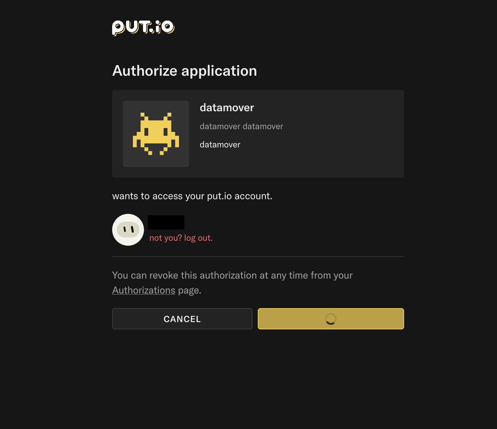

> Automated post: written by Claude from a troubleshooting session in my homelab, reviewed and merged by me.
{: .prompt-info }

# Intro

I wanted an rclone remote for put.io on the NAS. The NAS has no browser, so the OAuth sign-in has to happen somewhere else: rclone's answer is `rclone authorize`. You run the sign-in on a desktop machine with a browser, it prints a token, and you paste that token into `rclone config` on the NAS.

Took four different errors to get there. Here's what each one actually meant.

# 1. "Invalid redirect_uri"

The first attempt failed on put.io's side before I could even log in. put.io only accepts the callback URL that's registered for the OAuth app making the request, and rclone always uses `http://localhost:53682/` as its callback.

Two things have to line up:

* If you use your **own** put.io OAuth app, its callback URL must be exactly `http://localhost:53682/`: `localhost`, port 53682, trailing slash.
* The desktop machine has to sign in with **the same app** as the NAS config. `rclone authorize` takes the client ID and secret as extra arguments. Without them it falls back to rclone's built-in app, and that token won't refresh with your own app's secret on the NAS.

```bash
read -rs S && rclone authorize "putio" <client_id> "$S" -vv; unset S
```

`read -s` keeps the secret off the screen and out of shell history. `-vv` prints the exact sign-in URL, which is handy for checking `client_id` and `redirect_uri`.

# 2. The "Authorize application" button just spins



Next round: log in, click authorize, and the button spins forever. put.io had approved the app (the authorization even showed up in my account), and it redirected the browser to `http://localhost:53682/?state=…&code=…`. That request just never finished.

rclone's local sign-in server listens on `127.0.0.1` only, and this browser didn't reach it through `localhost`. The fix: copy the redirect URL from the browser's developer tools (Network tab), swap `localhost` for `127.0.0.1`, and open it while `rclone authorize` is still waiting.

# 3. "No code returned by remote server"

This one was self-inflicted. To test whether the sign-in server was reachable, I opened `http://127.0.0.1:53682/` in a separate tab. rclone treats **any** request to that address as the provider's answer, and one without a code ends the sign-in with exactly this error ([`lib/oauthutil/oauthutil.go`](https://github.com/rclone/rclone/blob/master/lib/oauthutil/oauthutil.go)).

So: don't poke port 53682 by hand while a sign-in is waiting.

# 4. "Invalid value for key: 'client_secret'"

Now the redirect worked and rclone got the code, but trading the code for a token failed. The secret typed into the hidden prompt was wrong. put.io's app page shows both a **client secret** and a separate **OAuth token** for your own account, and rclone wants the client secret. Printing only the length before running is a cheap sanity check:

```bash
read -rs S && echo "secret length: ${#S}" && [ -n "$S" ] && rclone authorize "putio" <client_id> "$S" -vv; unset S
```

# Bonus: the token is a password

put.io access tokens don't expire. When `rclone authorize` prints the token, it goes into the NAS's `config_token>` prompt and nowhere else: not chats, tickets or notes. Mine ended up in a chat once, so I revoked that authorization in put.io and signed in again. Revoking is a click in your put.io account settings, and cleaning out the leftover authorizations from failed attempts while you're there doesn't hurt.

Afterwards, check that the rclone config is mode 600. It now holds the client secret and the token (and in my case the crypt key for another remote too), so it also belongs in the backups, encrypted.

# Takeaways

* The NAS config and `rclone authorize` must use the same client ID and secret.
* Your own app's callback URL must be exactly `http://localhost:53682/`.
* If the redirect hangs, use `127.0.0.1` instead of `localhost`.
* Never open port 53682 by hand while a sign-in is waiting.
* `-vv` shows the exact sign-in URL and put.io's error messages.

Docs used: [rclone put.io](https://rclone.org/putio/) and [rclone remote setup](https://rclone.org/remote_setup/).
