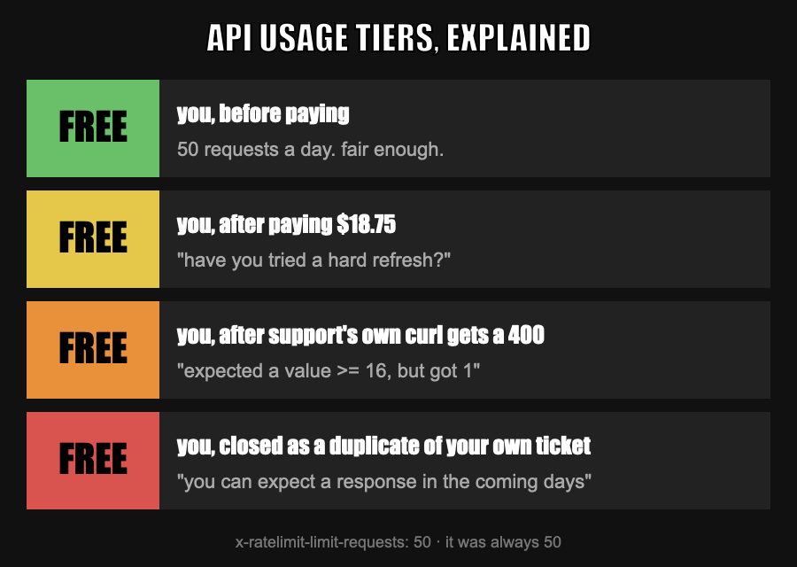

# Intro

My media sorter in the homelab uses an LLM to figure out what a file actually is. Works great. Until it doesn't.

Last night it stopped with this:

```console
429 - Rate limit reached for gpt-6-luna ... on requests per day (RPD): Limit 50, Used 50, Requested 1.
You can increase your rate limit by adding a payment method to your account.
```

M'ok. That's the free tier. So I did the adult thing and bought credits. Three times, actually: $6.25, $6.25, $6.25. (That's $5 plus what's probably Swedish VAT, each. Feeding a parking meter five bucks at a time, like a pro.)

The Build tier is supposed to kick in automatically at $5 of purchases. I was at three times that. Spoiler: it did not kick in.


OpenAI-generated image goes here, e.g.:
{: w="700" }
_Generated by OpenAI. Probably on the free tier._


# The problem.

The Limits page still said **Free**. 10 RPM, 50 RPD. So I opened the AI support chat. And that's where the fun starts.

## Round 1 - have you tried turning it off and on again?

* Are you looking at the right organization? *I have one. Just the one.*
* Hard refresh. Sign out and in. Another browser. Incognito. Clear site data.
* Wait a few minutes. *It's been a day.*

## Round 2 - just click "Upgrade tier"

Clicking "Upgrade tier" means... buying more credits. So the answer to "I paid and didn't get the tier" was "have you tried paying?". Sigh...

## Round 3 - debugging with support's own curl commands

Support kindly handed me curl commands to dump the rate-limit headers.

* Curl #1 sent `max_output_tokens: 1`. The API answered *"Expected a value >= 16, but got 1 instead."* So support's command got rejected by the very API it was supporting. Lol.
* Curl #2 grepped for the headers. Nothing.
* Curl #3 wrote the response to one file and then grepped a *different* file that was never written, with `2>/dev/null || true` so it failed nice and quietly. Bash at its finest.

The verdict: the `x-ratelimit-*` headers "are optional". Sure.

## Round 4 - support asks me to hammer the API

How do you get a 429 on purpose? Support's advice: fire 15 parallel curls at it. Customer support telling me to go rate-limit-test their API. As a detection engineer, I respect it.

And it worked:

```console
HTTP/2 429
x-ratelimit-limit-requests: 50
x-ratelimit-limit-tokens: 60000
x-ratelimit-reset-requests: 21h54m40.695s
```

Proof, in their own headers. 50 requests a day. Free tier.

The bot: *"Escalated to a support specialist. You can expect a response in the coming days."*

Me: "hello"

Me: "is this escalated?"

The void: ...

## Round 5 - new chat, same movie

So I started over and pasted all the evidence up front. Same refresh, same "right org?", same Upgrade-tier routine.

Bonus scene: support saw `openai-organization: user-...` in my headers and went *"that is not an org ID, your requests might be going to another org"*. So I asked `/v1/me`. That `user-...` thing is just my org's **name**. Same org. One org. I have one org.

Finally I pointed out that it already had every invoice ref, request ID and timestamp from the first chat. And it closed the chat... **as a duplicate of the escalated case.** The one nobody answers. Puh....

{: w="700" }
_The official usage tier ladder, as seen from my account._

## Bonus round - because I'm petty

My first 429 was at 23:43:44. My third credit purchase went through at 23:45. So for about 90 seconds there the free tier was the right call. For the next eleven hours, not so much.

# What now?

The good part: Claude added a cheap limit check to the sorter that runs before anything else. One minimal request, read the `x-ratelimit-*` headers, log them:

```console
sorter: llm limits (openai, gpt-6-luna): requests 21/50 left (resets in 13h38m59s), tokens 60000/60000 left (resets in 0s)
```

So now my own code tells me I'm on the free tier on every run, faster and more honestly than the support chat. It also honours `Retry-After` on a 429 instead of hammering the endpoint. Unlike some people. (Me. Because support told me to.)

TL;DR for next time:

* Paying is not the same as a tier upgrade. Check the headers, not the billing page.
* `x-ratelimit-*` headers are the source of truth. On a 200 they may be missing, on a 429 they're right there.
* `max_output_tokens` has a minimum of 16. Even if support says 1.
* "Escalated" is a state, not a promise.

Docs used: [OpenAI rate limits](https://platform.openai.com/docs/guides/rate-limits).

I'll update this when a human answers. If one exists. Until then, cheers!

---

> Automated post: written by Claude from my support chat logs, reviewed and merged by me. Support's lines are paraphrased.
{: .prompt-info }
