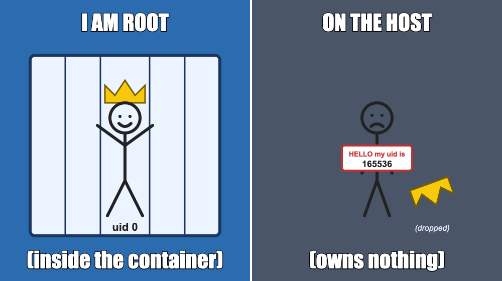

# Intro

Same new NAS as [last time](/posts/trouble-in-paradise-pt7-my-nas-only-does-small-talk/). The network thing has a watchdog now, so on to the next box on the test plan: **can Docker on this thing run with user namespace remapping?**

Short version for the non-Docker people: by default, `root` inside a container is `root` on the host. Same uid 0. The container is fenced in by namespaces and capabilities, but if something breaks out, it breaks out as root. On a box that holds every backup I own, that's not a nice thought.

`userns-remap` fixes that. Container uid 0 becomes some boring high uid on the host, like 165536, that owns nothing. Break out, and you're nobody. {: w="700" }
_The crown doesn't survive the trip to the host._

One line in `/etc/docker/daemon.json`:

```json
{ "userns-remap": "dockremap" }
```

How hard can it be?

# The problem.

MOS, the OS on this NAS, runs from RAM. `/etc` is rebuilt from the image on every boot. Only `/boot` (the USB stick) persists.

So:

* `daemon.json` lives in `/etc/docker/`. **Gone at reboot.**
* The uid ranges for the remap live in `/etc/subuid` and `/etc/subgid`. **Gone at reboot.**
* The `dockremap` user lives in `/etc/passwd`. You guessed it.

I tested it by hand first, and it works. Docker gets a separate data root (`/var/lib/docker/165536.165536`), files written by container root show up on disk as `165536:165536`, and the MOS stacks UI copes fine. Reboot, and it's all back to plain root like nothing happened.

## Attempt 1: the obvious setting

`/boot/config/docker.json` has a key called `docker_options`. Perfect, right? I set it, restarted Docker... no flag. Toggled Docker in the UI... and the UI wrote the key back as an empty string.

(Spoiler: the key *does* work, just not the way I tested it. More on that further down.)

## Attempt 2: the cron hammer

Plan B: a script on the stick that writes the three files and restarts Docker if it runs without remap. Cron every minute.

The first version had a fun bug. The script took a lock (one run at a time), then restarted Docker. `dockerd` was started by the script, so it **inherited the open lock file** and kept holding it. Forever. Every run after that saw the lock, assumed another run was busy, and quietly exited. Including `--check`. A watchdog that's locked out by the thing it's watching. Nice.

Fix: close the lock before calling the init script. Lesson noted.

Rebooted, and the remap was back after about two minutes. Great success? Not really. My test container didn't come back.

## The race

Reading the MOS boot scripts explained it:

1. MOS starts Docker.
2. MOS starts a **one-shot** autostart in the background: wait `start_wait` seconds, then start the containers and stacks marked autostart.
3. Cron starts last, and my script restarts Docker.

And the Docker init script's `stop` runs `docker stop` on every compose container. Docker then treats them as stopped on purpose, so `restart: unless-stopped` doesn't bring them back. So if MOS's autostart wins the race, my restart stops everything it just started. If my script wins, fine. That's not a fix, that's a coin toss with extra steps.

(To be fair, this particular test container was already dead before the reboot, *and* its autostart was off. I was debugging two problems and a non-problem at the same time. Lol.)

## The actual answer was in the boot script

Further up in that same MOS boot script:

```sh
start_script() {
  if [ -f /boot/optional/scripts/pre-start.sh ] ; then
    ...
```

A user hook. On the stick. Run **before** Docker, LXC and cron start.

So the script moved there. At boot it writes the user, the uid range and `daemon.json` into the fresh `/etc`, sees that Docker isn't running yet, and exits. Docker's very first start is already remapped. No restart, no race, nothing for autostart to trip over.

| Reboot test | Result |
|---|---|
| config written | before Docker started |
| Docker | remapped on the first start, no restart |
| MOS autostart | test stack up about 2 min after boot |
| file written by container root | owned by `165536` on disk |

Puh.... Finally.

The cron job stays as a guard: re-apply the config if someone starts Docker outside of boot, restart once if Docker ever runs unremapped, and complain loudly if something it didn't write shows up.

# What now?

The trade-offs, because it's not free:

* **Separate store.** Remapped Docker has its own data root. Existing images, containers and volumes aren't visible after the switch. Do it on day one, not with 30 stacks running.
* **Ownership.** Every appdata folder must be owned by `165536 + the container's uid`. Restoring appdata from the old box means re-owning it. Forget that, and things will fail with permission denied.
* **Autostart is mandatory.** Because MOS stops containers on purpose at shutdown, only stacks with autostart on come back. A restart policy alone isn't enough.
* **Some things need the real host.** A couple of containers (the Docker socket proxy, the monitoring agent) get `userns_mode: host` with a written reason. The GPU for transcoding is still a "test it and see": the render device's group doesn't map into a remapped container by default.
* **Pin the range.** Docker can pick a uid range by itself (`default`). Don't let it. LXC on this box uses `100000` and comes up *after* Docker at boot, so an automatic pick could land on the wrong range one day and every file in appdata would suddenly belong to a stranger. So the range is fixed in my settings, and the script refuses to run if anything overlaps it.
* **MOS updates.** All of this leans on MOS internals: the pre-start hook, the init script. The script records a checksum of the Docker init script and alerts if an update changes it. Then I read the new one and re-approve it. Homelab-grade, but at least it doesn't change quietly.

And the plot twist: there *is* a field for Docker start parameters in the MOS service settings. It writes `docker_options`, and a restart from the UI passes it to `dockerd`. My first test just went through the init script directly, which skips it. Doesn't change the answer though: the remap user and its uid range have to exist **before** Docker starts, and `/etc` is fresh on every boot, so the pre-start hook is needed either way. And setting `--userns-remap` there *and* in `daemon.json` makes `dockerd` refuse to start at all. Don't do both.

A bug report is going to the MOS devs: a persistent `daemon.json` (copy it from the stick before Docker starts) would make all of this a three-line job.

For anyone else on MOS, I made it a script: [`bootstrap-docker-userns.sh`](https://github.com/kaywoz/home0ps/blob/main/config-files/mos/bootstrap-docker-userns.sh). It checks for conflicts first, installs the hook and the pre-start call, and prints the bits you have to click in the UI yourself. `--uninstall` if you change your mind.

TL;DR for next time:

* RAM-based OS? Look for its **boot hooks** before building cron contraptions.
* Anything your script starts inherits your open files. Close your locks.
* "Restart: unless-stopped" means nothing if the OS stops containers on purpose.
* Test settings through the same path the OS uses at boot, not a shortcut.

Aight peace!

---

> Automated post: written by Claude from our test session on the new NAS, reviewed and merged by me. The lock bug and the coin-toss restart were Claude's too.
{: .prompt-info }
